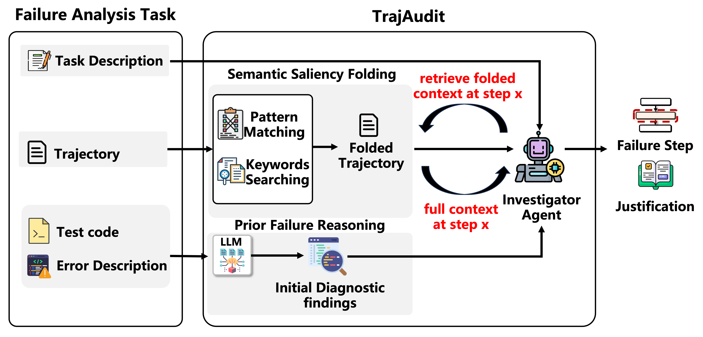

# TrajAudit: Automated Failure Diagnosis for Agentic Systems in Software Maintenance 

RootSE is also available on HuggingFace: [dengdan1999/RootSE](https://huggingface.co/datasets/dengdan1999/RootSE)

# Workflow of TrajAudit

TrajAudit consists of one investigator agent supported by two modules. The project structure follows this modular design.

# Project Structure
```
agent_system_log_normalization
├── RootSE/                          # RootSE benchmark: agent trajectories and failure annotations
│   ├── auto-code-rover/             #   AutoCodeRover agent trajectories
│   ├── openhands/                   #   OpenHands agent trajectories
│   ├── swe-agent/                   #   SWE-agent trajectories (Claude, Gemini, GPT backbones)
│   └── swe-agent-live/              #   SWE-agent-live trajectories
│
├── TrajAudit/                       # Core TrajAudit implementation
│   ├── fault_localization.py        #   Base investigator agent
│   ├── fault_localization_claude.py #   Claude-specific variant (strict JSON output)
│   ├── fault_localization_generic.py#   Generic OpenAI-compatible variant
│   └── template.yaml                #   Prompt templates and tool definitions
│
├── baseline/                        # Baseline methods for comparison
│   ├── who_and_when/                #   Prompt-only baselines
│   │   ├── all_at_once.py           #     Single-pass full-trajectory prompting
│   │   ├── binary_search.py         #     Binary search over trajectory steps
│   │   └── step_by_step.py          #     Sequential per-step analysis
│   ├── trail/
│   │   └── trail_adapted.py         #   TRAIL adapted for failure localization
│   └── FAMAS/
│       ├── famas.py                 #   FAMAS adapted for failure localization
│       └── collect_*.py             #   Reference trajectory collection scripts
│
├── output/                          # Evaluation outputs
│   ├── agent_locate/                #   TrajAudit results (per backbone model)
│   │   ├── claude-sonnet-4-5-*/     #     Claude Sonnet results
│   │   ├── deepseek-v4-pro/         #     DeepSeek results
│   │   ├── gemini-3.1-pro-preview/  #     Gemini results
│   │   ├── gpt-5.2-2025-12-11/      #     GPT results
│   │   └── qwen3-235b-*/            #     Qwen results
│   ├── FAMAS/                       #   FAMAS baseline results
│   ├── TRAIL/                       #   TRAIL baseline results
│   ├── all_at_once/                 #   All-at-Once baseline results
│   ├── binary_search/               #   Binary Search baseline results
│   ├── step_by_step/                #   Step-by-Step baseline results
│   └── overall_accuracy_log.txt     #   Aggregated evaluation results across all methods
│
├── config.py                        # API key, model, and experiment configuration
├── eval.py                          # Main evaluation entry point
├── utils.py                         # Shared utilities (SSF, data loading, etc.)
├── evaluate                         # CLI wrapper for running evaluations
├── requirements.txt                 # Python dependencies
├── resources/                       # Images used in README
└── README.md
```

# Quick Start
### 1. Environment Setup
```bash
conda create -n trajaudit python=3.12.7
conda activate trajaudit

pip install -r requirements.txt
```

### 2. Configure API credentials
Fill in your API key, base URL, and model in `config.py`:
```python
BASE_URL = "YOUR_BASE_URL"
API_KEY  = "YOUR_API_KEY"
MODEL    = "claude-sonnet-4-5-20250929"   # or any OpenAI-compatible model
```

### 3. Run evaluation
```bash
./evaluate agent_locate      # TrajAudit (ours)
./evaluate all_at_once
./evaluate step_by_step
./evaluate binary_search
./evaluate trail
./evaluate FAMAS
```